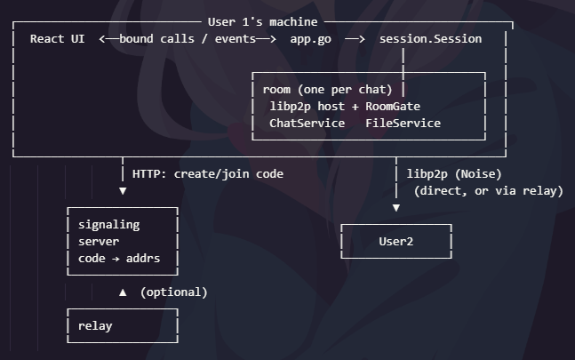

# Unakite

Proof-of-concept, account free and encrypted p2p messaging and file sharing desktop application.

Written in TypeScript and Go, with Wails acting as the framework which ties the front-end with the back-end and builds a clean and easy to use .exe.

## Credits

* Wails: https://wails.io/
* Go: https://golang.org/
* TypeScript: https://www.typescriptlang.org/
* Effective Go: https://go.dev/doc/effective_go
* Libp2p: https://libp2p.io/
* https://learnxinyminutes.com/

## What is this, and why?

I wanted to understand how Go differs from Java in terms of design methodology, and how to effectively use it in production level software. The idea for a p2p chat room software came from my interest in internet privacy. It was either this, or working on a VPN proof-of-concept (which might come around, as I enjoy Go). I think Go is a solid language, and libp2p taught me more about networking than I thought it would.

## Architecture

Design architecture given below:

## Application Layer

1. Identity

GenerateEphemeralIdentity() returns a fresh Ed25519 key and its PeerID. Nothing is written to disk. A new one is created every time a room is created or joined, and dropped when the room closes, so nothing links one room to the next.

2. p2p/host.go

* NewHost(priv, opts...) starts a libp2p host on a random TCP port (/ip4/0.0.0.0/tcp/0) with Noise as the only security transport. Extra options (the gater, relay settings) are passed in.
* FullAddrs(h) returns the host's addresses with /p2p/<PeerID> appended: a dialable string.
* ConnectAddrs(ctx, h, addrs) parses addresses and requires them all to name exactly one peer, then dials. The Noise handshake then verifies the remote really is that peer. A forged PeerID fails.
* Connect is the single-address wrapper.

3. p2p/chat.go

* Registers protocol /poc-chat/1.0.0 on the host.
* Messages are ChatMessage{Type, Nickname, Content, Timestamp} encoded as newline-delimited JSON (json.Encoder / json.Decoder).
* One long-lived outbound stream per peer. Bytes on one stream arrive strictly in order. Opening a stream per message would let messages overtake each other.
* On receive, libp2p calls handleStream in its own goroutine, which decodes in a loop and calls the onMessage(from, msg) callback. from is the authenticated PeerID.

4. p2p/file.go

One stream per file, independent of chat. Hence, a large transfer never blocks messages.

* Control messages are length-prefixed JSON frames (4-byte length, then JSON). File bytes are raw. A json.Decoder would read ahead and swallow file bytes, which is why chat's framing isn't reused here.
* The copy loop (copyExactly) moves 64 KiB at a time. A slow receiver blocks Write, which slows the sender's reads, so backpressure comes free and memory stays flat for any file size.
* Integrity: SHA-256 is computed while streaming (io.TeeReader on send, io.MultiWriter on receive). Noise already detects tampering in transit, so the hash guards against truncation and bugs.
* The sender reports "complete" only after the receiver's result frame.
Timeouts: 2 minutes for a human to decide, 30 seconds of idle silence during transfer (reset on every chunk), so a stalled peer fails but a legitimately long transfer doesn't.
* Defending against a hostile sender (the receiver treats the other side as untrusted):
    * SanitizeFileName reduces any name to a bare filename: strips path parts from both / and \, control and Windows-illegal characters, trailing dots, reserved device names (CON, NUL...), and caps the length.
    * Size cap (1 GiB) checked before the user is asked.
    * At most 3 incoming transfers at once (a buffered channel used as a semaphore).
    * Temp file with a random name, then atomic move into place. O_EXCL guarantees nothing is overwritten (a.txt becomes a (1).txt).
    * Every failure path deletes the temp file, so aborted, corrupt and declined transfers leave nothing behind.
    * The receiver generates its own transfer IDs (r1, r2...), and the sender uses s1... The remote side never chooses an identifier.
* FileService reports through two callbacks the session supplies: OnOffer (blocks while the human decides) and OnProgress (throttled to about 10 updates per second per transfer).

6. Signaling

Store:

* Create(addrs) returns a random 8-character code from a 32-symbol alphabet (no 0/O/1/I), which is 40 bits from crypto/rand.
* Consume(code) returns the addresses and deletes the code, under one lock, so exactly one caller can win. Unknown, used and expired codes all return the same ErrNotFound.
* TTL defaults to 10 minutes and is enforced at lookup time. A background janitor only tidies memory.
* The store validates the number and size of addresses, but treats them as opaque strings.

Server:

* POST /rooms with {"addrs":[...]} returns 201 {"code": "..."}
* POST /rooms/{code}/join returns 200 {"addrs":[...]}, or 404
* It is a POST on purpose: joining destroys the code, and GET is expected to be safe and repeatable.
* Request bodies are capped (413), unknown JSON fields rejected, responses are Cache-Control: no-store, and server timeouts are set. There is no request logging, so it never records IPs.

Client:

Wraps both endpoints.

7. p2p/room.go and p2p/relay.go

* CreateRoom(ctx, sc, h): publish this host's addresses, get a code.
* JoinRoom(ctx, sc, h, code): consume the code, then ConnectAddrs to whatever it returns.
* Relay: CreateRoomViaRelay waits until the host holds a reservation on the relay (a /p2p-circuit address appears), then publishes only relay addresses of the form <relay>/p2p/<relayID>/p2p-circuit/p2p/<hostID>. LAN addresses are not published.
* HostRelayOptions / GuestRelayOptions set ForceReachabilityPrivate, enable hole punching, and for the host, register the static relay for auto-reservation.

8. Session

Owns at most one room at a time and everything inside.

9. app.go

Creates a session at startup.

## Limitations (outside of POC scope)

* No rate limiting on signaling (brute force is impractical: 40 bits, 10-minute TTL, single use).
* The relay has no access control and infinite limits, so anyone who knows its address can use its bandwidth.
* Signaling is plain HTTP unless you add TLS.
* Rooms are strictly 1:1. No groups, no multi-device, no offline delivery.
* Disk space isn't checked before accepting a file.
* No resumable transfers, no cancel button (leaving the room is the cancel), no "open folder" button.
* The host's cached chat stream isn't refreshed after a guest reconnects (the first reply after reconnect can fail once).
* A peer that crashes or loses power is noticed slowly (libp2p keepalive timeout).
* With a relay configured, even two people on one LAN go through it until a direct path is punched.
* No app-layer encryption on top of Noise. Noise is already authenticated end to end, and an extra layer would be the defense-in-depth next step.